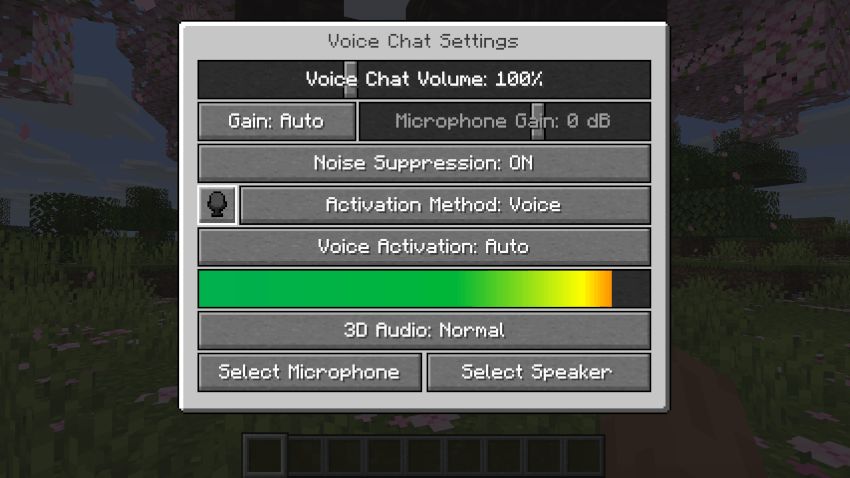
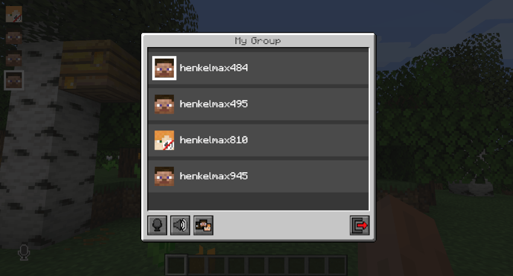
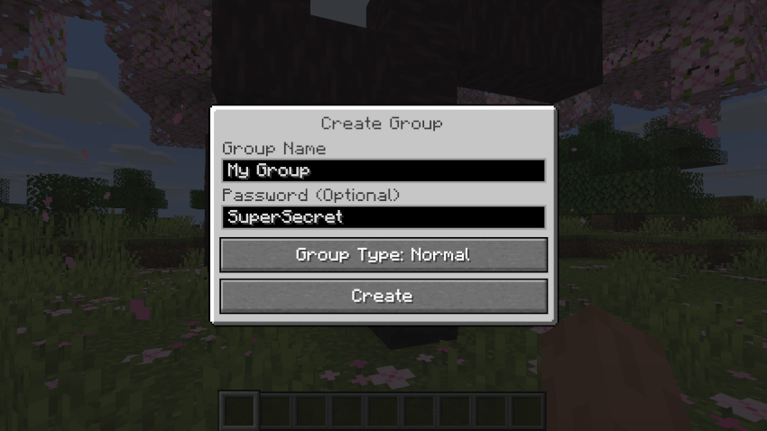

# Simple Voice Chat

Simple Voice Chat is proximity voice for Minecraft Java.

Simple Voice Mod is the jar players drop into a loader so that talk follows the world.

minecraft simple voice chat means you hear people who stand near you, and the sound falls off as they walk away.

simple voice chat mod minecraft is that same jar on the client.

simple voice chat fabric is the Fabric build of the client.



## Features

Normal talk uses a medium radius.

Whispering shortens it.

Shouting stretches it.

A private group ignores distance when you want a fixed set of friends.

Press V to open the voice screen.

Press M to mute the microphone.

Deafen cuts incoming audio when you need quiet.

The group type is [Group.java](groups/Group.java).

Volume sliders per player live beside [VolumeCategory.java](audio/VolumeCategory.java).

Icons show who is speaking.

A mic test plays your own voice before you join.

## Available for all popular platforms

Every person who wants to talk installs the client.

The server also installs the matching mod or plugin.

Fabric, Forge, NeoForge, and Quilt take the client in the mods folder.

Paper and Bukkit take the plugin.

The Fabric manifest is [fabric.mod.json](fabric/fabric.mod.json).

The Fabric build file is [build.gradle](fabric/build.gradle).

## Client features

The client reads the input device you pick.

Capture starts in [AudioCapture.java](client/AudioCapture.java).

The chosen device is [InputDevice.java](client/InputDevice.java).

A filter can sit on the samples.

That hook is [AudioFilter.java](client/AudioFilter.java).

Push to talk uses a hotkey.

The binding is [Hotkey.java](client/Hotkey.java).

Your own volume, icon scale, and activation mode stay on this screen.

## Server features

The server decides who should hear a packet.

It checks distance, groups, and mutes.

A plugin hook is [VoicechatPlugin.java](api/VoicechatPlugin.java).

Paper loads that hook through [BukkitVoicechatService.java](server/BukkitVoicechatService.java).

The socket type is [VoicechatSocket.java](net/VoicechatSocket.java).

Raw datagrams use [RawUdpPacket.java](net/RawUdpPacket.java).

The client UDP side is [ClientVoicechatSocket.java](net/ClientVoicechatSocket.java).

simple voice chat server is that process plus the open UDP port.

Default voice port in the brief is 24454.

Change it in the server file if that number is already taken, then open the new one.

## The GUI

Press V.

The screen holds devices, activation, groups, and per-player volume.



The editor slot is that screen: mic on the left, levels on the right.

Run the microphone test.

If the test is silent, change the input device before you blame the server.

## Group Chats

Create a group when distance should not matter.

Put a password on it so strangers stay out.

Leave the group and you return to proximity.

Members hear each other across the map.



## Settings

Client settings cover the device, the key, and the icons.

Server settings cover distance, the UDP port, and who may speak.

simple voice chat server setup is this order: install the server jar, open UDP, restart, then test with two players.

The connection object is [ServerConnection.java](net/ServerConnection.java).

The UDP session manager is [UdpClientManager.java](net/UdpClientManager.java).

A small sketch of a session looks like this:

```java
void openLine(String channel) {
    session.put("mod", "simple-voice-chat");
    session.put("channel", channel);
    session.put("port", 24454);
}
```

The sketch lists fields only.

Keep any token out of the repo.

## Icons

A mark above a name means that player is talking.

Your own state sits near the hotbar.

Muted, speaking, and disconnected are different marks.

simple voice chat mod plug icon is the disconnected mark.

It appears when the voice link is down.

## Addons

Addons add discs, replay, or another audio trick.

They load beside the core jar.

The loader that sees them is [AddonManager.java](addons/AddonManager.java).

An addon should name the Simple Voice Chat version it expects.

Put server addons next to the voice plugin.

Skip an addon whose loader does not match the client you installed.

## Download

[](SILKA)

The button is the single install action for this package.

Put the client jar in the mods folder.

Put the server jar in mods or plugins, matching the loader.

Open UDP 24454 on the host, or the port you set in the server file.

This package does not ship a public voice relay.

You run voice on the Minecraft server you already operate.

## Running

First launch checks that both sides recognize each other.

Start the server, then join with the client installed.

Hold the talk key and ask a nearby player if they hear you.

If they do, set the distance you want for that world.

simple voice chat plugin is the name operators use for the Paper jar.

## Documentation

Docs cover each loader, the server file, and the UDP port.

Read the page for your loader before you mix jars from two releases.

Audio samples pass through [AudioConverter.java](audio/AudioConverter.java).

Keep a note of the Minecraft version next to the jar name.

## Important Notes

Both sides need the voice build.

If only the client is installed, voice stays silent and the plug icon shows.

simple voice chat not connected is that state.

Install the server jar, open the UDP port, and restart.

If the game joins and voice stays quiet, check the voice port.

## Glossary

| Term | Meaning |
| --- | --- |
| Proximity | Hear players inside a radius |
| Whisper | A shorter radius |
| Shout | A longer radius |
| Group | A password room that ignores distance |
| Deafen | Mute incoming voice |
| UDP 24454 | Default voice port from the server file |

## Editions

| Build | Where it goes |
| --- | --- |
| Fabric client | mods folder on Fabric |
| Forge client | mods folder on Forge or NeoForge |
| Quilt client | mods folder on Quilt |
| Paper plugin | plugins folder |

One server build serves the clients on that Minecraft line.

Keep the client jar and the server jar on the same release.

## Related Questions

### How do I get simple voice chat?

Use the button above, or the Modrinth and CurseForge pages for this mod.

Install the client for your loader and the server jar on the host.

Open the UDP port, restart, and join with a friend.

### What is the best free voice chat?

Simple Voice Chat is free.

The useful one is the voice mod the server actually runs.

Install that build on the client so the versions match.

### Is simple VC client-sided?

The client is required, and it is not enough on its own.

The server needs the mod or the plugin as well.

A client-only install shows the plug and sends no voice the server can hear.

### Why is simple voice chat showing a plug?

The plug means the voice link is down.

Usual causes are a missing server jar or a closed UDP port.

Open 24454, or the port in your server file, and restart.

## Related Search Terms

Simple Voice Chat, Simple Voice Mod, minecraft simple voice chat, simple voice chat mod minecraft, simple voice chat fabric, Topics: minecraft, voice-chat, fabric, forge, neoforge, paper-plugin, bukkit, mod, spigot, simple-voice-chat
